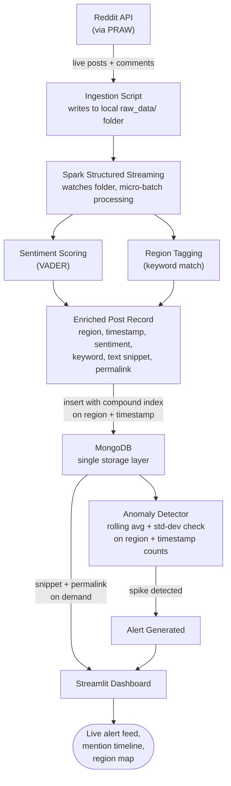

# Disaster Early-Warning System from Social Media Chatter

A real-time pipeline that monitors social media for disaster-related keywords, detects abnormal spikes in mentions per region, and raises early warning alerts — before official news catches up.

Built as a semester project for **Big Data Programming Tools**, using Spark Streaming and MongoDB together as a lean, real-time detection pipeline — no Hadoop cluster required.

## Core Idea

People post about floods, earthquakes, and wildfires on social media *before* agencies confirm them. This system watches that chatter, counts mentions per region in near real-time, and flags a sudden spike as a potential early warning.

## System Flow



**Reading the diagram:** Reddit posts flow in continuously → Spark processes them as they arrive, scoring sentiment and tagging region → each post becomes one enriched document stored in MongoDB (indexed for fast querying) → the anomaly detector queries MongoDB directly for mention counts per region → confirmed spikes and post snippets both surface on the dashboard.

## Tech Stack & Why Each Tool Is There

| Tool | Used For | Why This Tool |
|---|---|---|
| **PRAW** | Pulling live posts from Reddit | Free, reliable API — unlike Twitter/X's restricted free tier |
| **Apache Spark (Structured Streaming)** | Processing posts as they arrive, in micro-batches | Purpose-built for continuous, near-real-time data processing |
| **MongoDB** | Storing enriched post records; fast region + time-window queries | A compound index on `region + timestamp` gives fast range-scans without a second database — simpler architecture, same performance for this scale |
| **VADER Sentiment** | Scoring urgency/sentiment per post | Lightweight, free, no GPU needed |
| **Streamlit** | Dashboard — alerts, timeline, map | Fast to build, pairs well with Python backend logic |

## MongoDB Document Schema

```json
{
  "region": "Assam",
  "timestamp": "2026-09-12T14:32:00Z",
  "sentiment_score": -0.72,
  "keyword_matched": "flood",
  "text_snippet": "Water levels rising fast near...",
  "permalink": "https://reddit.com/r/india/..."
}
```

**Compound index:** `{ region: 1, timestamp: -1 }` — this is what makes "count mentions in the last 10 minutes" queries fast, doing the job a second indexed database would otherwise handle.

Only a short snippet (not the full post) and a link back to the source are stored — enough to show real evidence on the dashboard without hoarding full post bodies.

## Platforms

- Local machine / Google Colab for development
- Local Spark installation (no Hadoop/HDFS setup needed)
- MongoDB Community Server (local)
- GitHub for version control
- Reddit API — free tier

No paid cloud services or paid software anywhere in this stack.

## Development Phases

1. **Environment Setup** — PRAW authenticated and pulling posts into a local `raw_data/` folder; MongoDB running with the compound index created
2. **Streaming Pipeline** — Spark Structured Streaming job watching that folder and processing new posts as they arrive
3. **Enrichment** — sentiment scoring + region tagging
4. **Storage Layer** — writing enriched records into MongoDB
5. **Anomaly Detection** — rolling-average spike detector querying MongoDB directly
6. **Dashboard** — Streamlit UI tying it all together

## Expected Outcome

A live demo: post a burst of test messages with a disaster keyword, and watch an alert appear on the dashboard within seconds — backed by a genuine streaming pipeline with a deliberately simplified, single-database architecture.

## What This Project Demonstrates

- Real-time stream processing with Spark
- MongoDB schema and compound-index design for fast time-windowed queries
- Architectural judgment — evaluating a two-database design and simplifying to one after confirming it meets the performance requirement
- End-to-end pipeline thinking: ingestion → processing → storage → detection → visualization
